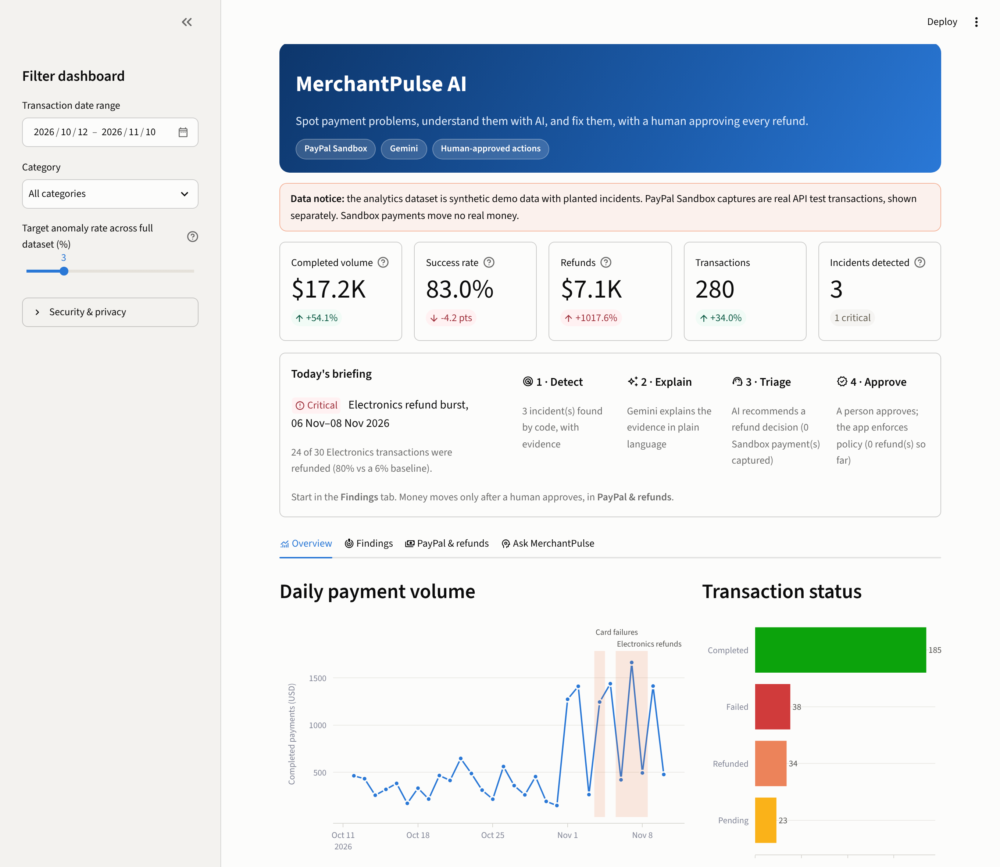
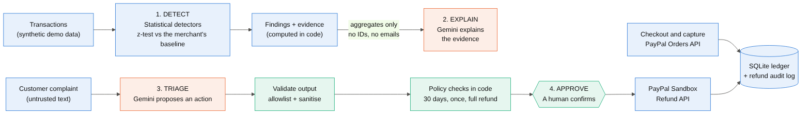

# MerchantPulse AI

**Find payment problems, understand them with AI, and fix them, with a human approving every refund.**

MerchantPulse AI is a merchant intelligence app built on the **PayPal Sandbox** and **Google Gemini**. Code detects incidents in a merchant's payments, Gemini explains them in plain language, and a human-approved refund assistant resolves customer complaints through PayPal's refund API.

Built for the **PayPal AI Hackathon** (Devpost).

- **Demo video:** _add YouTube link_
- **Hosted demo:** _add URL, or follow "Run locally" below_



## The idea in one picture

**Detect** (code finds incidents) → **Explain** (Gemini explains the evidence) → **Triage** (Gemini recommends a refund decision) → **Approve** (a person confirms; the app enforces policy; PayPal refunds).



## Why it matters

**Intended customer:** Small online merchants who accept digital payments but lack dedicated payment-operations teams to investigate payment failures, refund patterns and customer complaints. Published context, with its limits:

- US merchandise returns reached **USD 743 billion in 2023 (14.5% of sales)**, with an **online return rate of 17.6%** (NRF and Appriss Retail, [as reported by Shop! Association](https://shopassociation.org/many-unhappy-returns-743b-in-merchandise-sent-back-in-2023/)).
- In a 2023 survey of 200 subscription-business executives, **four in five failed payments were not the customer's fault** ([PYMNTS and Flex Pay](https://www.pymnts.com/subscriptions/2023/80percent-of-failed-subscription-payments-not-the-customers-fault/)). That survey covers subscription businesses, so it is context, not a measurement of this app's users.

The benchmark included with this project measures detector behavior on 100 reproducible synthetic datasets. It detected all 60 planted cases (20 each for card failures, refund bursts and overnight high-value transactions) and reported alerts in 4 of 40 no-incident benchmark cases. A separate 100-seed sweep of the usual 90-day baseline reproduced five no-incident alerts at seeds 5, 15, 53, 56 and 73. These synthetic results are useful for examining the detector, not proof of customer outcomes or real-world accuracy. See [the benchmark report](benchmark_results/summary.md) and [case-level CSV](benchmark_results/cases.csv).

## What it does

1. **PayPal Sandbox checkout (Orders v2).** Create a fixed-price test order, approve it with a Sandbox buyer account, and the server captures and verifies it.
2. **Incident detection (code, not AI).** The Card failure-spike and category refund-burst detectors compare short windows against the merchant's own baseline using one-sided proportion z-tests. The overnight high-value detector uses a 99th-percentile amount threshold (with a USD 500 floor) and a 00:00-05:59 time window. Each finding carries reviewable evidence and baseline-relative amounts; alerts still need investigation.
3. **AI explanations.** Gemini explains each finding in business terms and cites its numbers. It never calculates them. Gemini also answers free-form questions about revenue, failures, refunds and the PayPal ledger.
4. **Human-approved refund assistant (agentic commerce).** A customer complaint goes in. Gemini **recommends** a full refund, no refund, or manual review, with a rationale and a draft reply. A person **approves**. The app **enforces** the refund policy, then issues the refund through PayPal's refund API. A visible, persistent **Decision Receipt** records evidence, AI reasoning, the complaint safety-gate result, policy checks, approval state and the PayPal execution outcome as separate fields.
5. **Dashboard.** KPIs with period-over-period change, daily volume with incidents marked, status mix, revenue by category and payment method, a transaction explorer, and an Isolation Forest view of statistically unusual transactions.

## How the refund agent stays safe

| Layer | Rule |
| --- | --- |
| Gemini sees | Item name, amount, age and the complaint text after basic cleaning. Payment-record order IDs, capture IDs and payer-email fields are excluded. The complaint itself is not PII-redacted, so operators must not paste personal or payment credentials into it. |
| Pre-AI complaint safety gate | A local heuristic scans for instruction-like text (such as attempts to override rules, change the assistant's role, bypass approval, or request secrets). Matching complaints are quarantined for manual review before any Gemini request. This is a conservative pattern screen, not a complete prompt-injection detector; false positives are possible and novel attacks can evade it. See [the safety-gate demo and limitations](docs/COMPLAINT_SAFETY_GATE.md). |
| The complaint | Treated as **untrusted data**. Complaints that pass the local screen are sent in a data field, with a system prompt that tells Gemini never to follow instructions inside them. Gemini's response is also untrusted and must pass action allowlisting, sanitisation and application policy checks. |
| Gemini's answer | Treated as **untrusted**: must parse as JSON, the action must be on an allowlist, text is sanitised and links are removed. Anything else becomes "needs your review". |
| Policy (in code) | Full refunds only, within 30 days of capture, once per payment, only for payments this app captured. A failed check blocks a refund recommendation and blocks the refund itself. |
| Approval | The refund button is enabled only for a `refund_full` proposal when every policy check passes. `no_refund`, `needs_review`, safety-gated complaints, failed checks, and missing checks cannot be approved. Nothing is refunded automatically. A person must tick an explicit confirmation and click Approve. An optional PIN (`MERCHANT_APPROVAL_PIN`) is checked in constant time with attempt limiting; configure it before exposing a hosted demo publicly. |
| Idempotency | The database allows one refund per order, writes are serialised, and the PayPal request ID is deterministic, so a double click or a retry after a timeout can never refund twice. If PayPal's answer is ambiguous, the app looks the order up before deciding. |
| Audit log | Every refund records who proposed it (AI or manual), the AI's rationale, an approval-channel label (`merchant (dashboard)`), the reason and the time. The current prototype does not authenticate an individual merchant identity. |
| Decision Receipt | Every triaged refund creates a local structured receipt. It distinguishes a recommendation from pending approval and a PayPal-confirmed action. The receipt stores a masked copy of the customer's complaint (up to 500 characters, with email addresses and long digit strings replaced), so it is evidence-bearing text, not a hash; the Gemini request never includes IDs or emails. The receipt is a local prototype record, not a tamper-proof or identity-authenticated audit system. |
| Fallback | If Gemini is unavailable, a deterministic rule-based triage is used and the UI says so. |

## Other safety design

- Prices come from a **server-side catalogue**; the browser cannot set an amount.
- Only orders **created by this app** can be captured or refunded, and the captured amount and currency are verified against the order.
- Capture is **idempotent** and recovers from timeouts by looking the order up at PayPal.
- The app **refuses to run against a non-sandbox PayPal URL**.
- Buyer emails are **masked** in the UI. Gemini receives **aggregates only**.
- Gemini calls are **rate-limited per session** (`AI_CALLS_PER_10_MIN`, default 20) to protect quota.
- Secrets live only in `.env`, which is git-ignored along with the SQLite ledger.

## Data honesty

The dashboard analytics dataset is **synthetic demo data** (a reproducible generator) with three **planted incidents** so the detectors have example evidence to find. They are found by statistics, not hard-coded into the UI. The controlled 100-case benchmark found no-incident alerts in 4/40 cases; the separate fixed 100-seed baseline sweep found alerts in 5/100 cases. The false alerts are random clusters in the synthetic data that cross the current thresholds. Multiple dates, methods and categories are tested, so per-window thresholds do not control the overall false-alert rate. PayPal Sandbox captures and refunds are real API test transactions from this app, shown **separately**; no real money moves. The two sources are never added together.

The three financial measurements are intentionally separate:

| Measurement | Meaning |
| --- | --- |
| Excess failed-payment value | Value of failures above the expected baseline; not confirmed lost revenue. |
| Excess refund value | Refund value above the expected baseline; not proof of avoidable refunds. |
| Transactions under review | Value requiring investigation; not confirmed fraud or loss. |

All three are synthetic, detector-associated measurements, not realised loss, recovered revenue or causal estimates. The subscription-business survey above remains specific to subscription businesses and is not generalized to all merchants.

## Tools and how they are used

| Tool | Use |
| --- | --- |
| PayPal Sandbox REST API (OAuth2, Orders v2 create/capture/lookup, Payments v2 capture refund) | Checkout, server-side capture and verification, human-approved refunds |
| Google Gemini (`gemini-3.5-flash-lite`, via Google's OpenAI-compatible endpoint and the `openai` SDK) | Explains detected incidents, answers merchant questions, triages refund requests |
| scikit-learn Isolation Forest | Model-based transaction anomaly flags |
| NumPy, pandas | Proportion z-tests for failure/refund incidents, quantile threshold for overnight high-value orders, data handling |
| Streamlit, Plotly | App and charts |
| SQLite | Local order, capture and refund audit ledger |

## Reproduce the detector benchmark

From the project directory, run:

```bash
python benchmark_detectors.py
```

The command writes the fixed-seed report, summary JSON and case-level CSV under `benchmark_results/`. It runs 100 cases (20 normal, 20 per planted incident type, and 20 smaller no-incident cases), then repeats the usual 650-transaction no-incident generator across seeds 0–99 to inspect the five reproduced false-positive seeds. The benchmark is controlled synthetic validation only.

## Run locally

Requirements: Python 3.11+ (developed and tested on 3.13).

```bash
git clone <this-repo-url>
cd <repo-folder>
python -m venv .venv
# macOS/Linux:  source .venv/bin/activate
# Windows:      .venv\Scripts\activate
pip install -r requirements.txt
cp .env.example .env        # Windows: copy .env.example .env
# edit .env and add your own keys
streamlit run app.py
```

Open http://localhost:8501. The app works without a Gemini key (local analysis and rule-based triage) and shows a clear message if PayPal credentials are missing.

### Get credentials

1. **PayPal Sandbox:** at [developer.paypal.com](https://developer.paypal.com), create a Sandbox app for a Client ID and Secret, and create a Sandbox **Personal** (buyer) account.
2. **Gemini:** create an API key in Google AI Studio.

### Try it (about 3 minutes)

1. **Payments & refunds** tab: pick a demo item, click **Create PayPal Sandbox order**, then **Continue to PayPal Sandbox approval** and sign in with the Sandbox buyer account. You return to the app and the capture appears in the ledger.
2. **Problems found** tab: see the planted incidents, open the evidence, click **Explain with Gemini**.
3. Back in **Payments & refunds**: choose the payment, click an example complaint such as "Charged twice", click **Ask AI to triage**, review the recommendation and policy checks, tick the approval box, and click **Approve & issue Sandbox refund**. The ledger shows the refund and the PayPal Sandbox account shows it too.

`APP_BASE_URL` must match the address the app is served from, because PayPal redirects the buyer there.

### Check your PayPal credentials (optional)

```bash
python paypal_connection_test.py
```

## Tests

```bash
python -m unittest discover -v
```

The suite contains 78 automated tests across eight test modules (PayPal and Gemini are mocked; no keys needed). They cover capture and refund idempotency and concurrency, the refund policy window, timeout recovery, untrusted AI input and output, pre-AI complaint screening, fail-closed refund eligibility, Decision Receipt stages and masking, the detectors (including no false alarms on baseline data), the first-screen UI, checkout session-state cleanup, and that payment identifiers do not enter Gemini's payment context. Run them with `python -m unittest discover -v` after installing `requirements.txt`; the three Streamlit `AppTest` checks require Streamlit to be installed.

## Known limitations

- Analytics data is synthetic; only the checkout and refund ledger comes from the PayPal Sandbox.
- Capture is triggered by the buyer's return to the app; there is no webhook receiver yet.
- Refunds are full-amount only.
- The ledger is SQLite. On hosts with an ephemeral filesystem it resets when the app restarts.
- On a public hosted demo, set a strong `MERCHANT_APPROVAL_PIN` in the hosting environment before enabling refund approvals. The prototype records the approval channel label, not a verified account identity; do not describe the current audit label as authenticated merchant identity.

## License

MIT. See [LICENSE](LICENSE).
